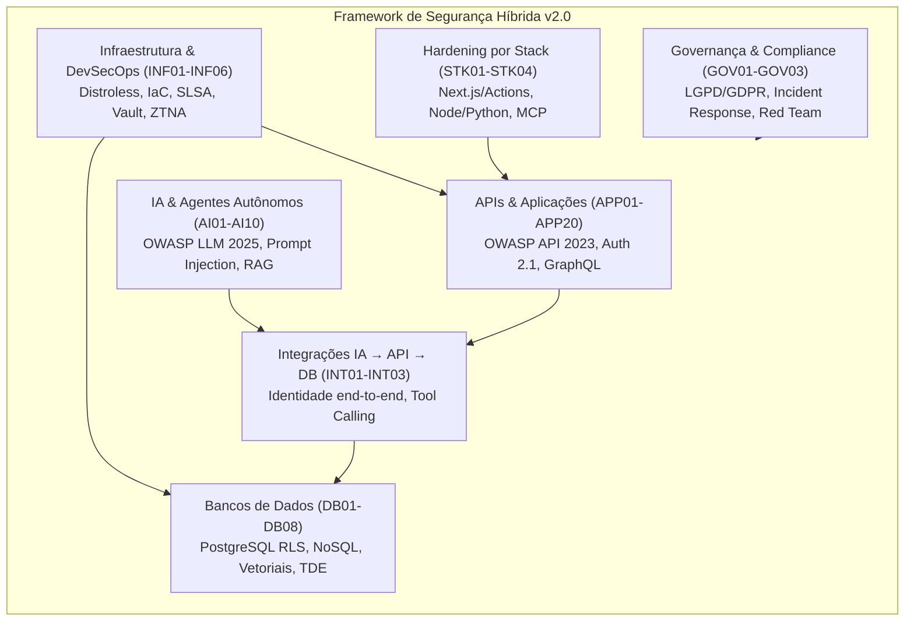

# 🛡️ Framework de Segurança Híbrida: Aplicações, APIs, Bancos, Infraestrutura e Agentes de IA

<div align="center">

[](LICENSE)
[-orange.svg)](https://owasp.org/www-project-api-security/)
[-red.svg)](https://genai.owasp.org/llm-top-10/)
[](docs/checklist-auditoria-50-controles.md)
[-purple.svg)](https://csrc.nist.gov/publications/detail/sp/800-207/final)
[](CONTRIBUTING.md)

**O guia operacional autossuficiente definitivo para auditoria, desenvolvimento seguro e remediação técnica em projetos modernos com ou sem Inteligência Artificial em produção.**

[Visão Geral](#-visão-geral) •
[Estrutura dos 50 Controles](#-estrutura-dos-50-controles) •
[Como Usar com Agentes de IA](#-como-usar-com-agentes-de-ia) •
[Guia Rápido](#-guia-rápido) •
[Documentação](#-documentação-adicional) •
[Licença](#-licença)

</div>

---

## 📌 Visão Geral

O desenvolvimento moderno de software — potencializado por *vibecoding*, assistentes autônomos de código, microsserviços e integração massiva de Modelos de Linguagem (LLMs) — acelerou a entrega de produtos, mas expandiu exponencialmente a superfície de ataque. 

Vulnerabilidades clássicas de autorização de APIs (**BOLA**, **BFLA**) agora se combinam com vetores inéditos de inteligência artificial generativa:
- **Injeção Indireta de Prompt** em documentos e ferramentas downstream;
- **Ataques de Agência Excessiva** (*Lethal Trifecta* / Rule of Two);
- **Envenenamento de RAG** (*PoisonedRAG*) e **Inversão de Embeddings** (*Vec2Text*);
- **Contaminação de pipelines CI/CD** e desvios de configuração em nuvem.

Este repositório fornece um **documento mestre único, executável e autossuficiente** ([`seguranca-hibrida-projetos-ia-api-bancos.md`](seguranca-hibrida-projetos-ia-api-bancos.md)), projetado para ser lido e aplicado tanto por **engenheiros de segurança e desenvolvedores** quanto diretamente por **agentes de IA** (como Claude Code, Cursor, Windsuit, GitHub Copilot, Roo Code, Antigravity) durante o ciclo de desenvolvimento e auditoria de código.

---

## 🧭 Princípios Fundamentais

1. **Negar por Padrão (*Default Deny*):** Todo acesso a recursos, APIs, tabelas ou ferramentas é bloqueado até que haja permissão explícita, contextual e autenticada.
2. **Menor Privilégio (*Least Privilege*):** Tokens, bancos de dados, contêineres e modelos de IA devem ter estritamente os privilégios mínimos necessários para sua função em tempo de execução.
3. **Segurança Fora do Modelo:** Nunca delegar decisões de autorização, autenticação ou integridade de dados ao próprio LLM. O modelo propõe; o backend confiável valida e executa.
4. **Isolamento Lógico e Criptográfico:** Multi-tenancy real em nível de banco de dados (Row-Level Security), segmentação de redes (Zero Trust / VPCs) e criptografia de ponta a ponta.
5. **Human-in-the-Loop (HITL) Obrigatório:** Operações financeiras, exclusão irreversível de dados e alterações críticas de infraestrutura exigem aprovação explícita e autenticada de um operador humano.

---

## 📋 Estrutura dos 50 Controles de Segurança

O framework está organizado em **7 domínios técnicos padronizados**, cobrindo 50 controles obrigatórios:



### Resumo das Famílias de Controles

| Família | Identificadores | Foco de Aplicação |
| :--- | :--- | :--- |
| **Aplicações e APIs** | `APP01` a `APP20` | Autenticação Argon2id, JWT/PASETO, BOLA (API1), Mass Assignment (API3), BFLA (API5), Injeções, SSRF IMDS (API7), Rate Limiting (API4), GraphQL Security (Trusted Queries, depth limit), Headers HTTP e TLS 1.3. |
| **Inteligência Artificial e RAG** | `AI01` a `AI10` | Injeção de Prompt (direta/indireta), Quebra da Tríade Letal (HITL), AI Supply Chain (Safetensors, AI-BOMs), Envenenamento de RAG, Prevenção de Vec2Text, Denial of Wallet (RPM/TPM caps) e Sandboxing de Saída. |
| **Bancos de Dados** | `DB01` a `DB08` | Segregação de identidades de conexão, PostgreSQL Row-Level Security (`FORCE RLS`), Criptografia (TDE/CLE), Connection Pooling (PgBouncer), NoSQL Injection, Bancos Vetoriais (pgvector/Pinecone/Chroma) e Regra de Backup 3-2-1-1-0. |
| **Integração IA → API → Banco** | `INT01` a `INT03` | Propagação de identidade e assertions de tenant em canais (WhatsApp/Webchat), ferramentas atômicas mediadas por schema e isolamento estrito de memórias/conversas. |
| **Infraestrutura e DevSecOps** | `INF01` a `INF06` | Contêineres Google Distroless non-root, Pod Security Standards Restricted, eBPF (Falco), IaC scanning (Checkov/Trivy), CI/CD SLSA Nível 2/3 com Cosign, Vault com credenciais dinâmicas e Redes Zero Trust com mTLS. |
| **Hardening de Stacks** | `STK01` a `STK04` | WordPress/PHP sem XML-RPC, React/Next.js (Server Actions protegidas individualmente e sem vazamento em SSR), Node/Python/Go (anti-pollution, cancelamento de contexto) e Model Context Protocol (MCP stdio/HTTP). |
| **Governança e Compliance** | `GOV01` a `GOV03` | Conformidade LGPD (prazo ANPD de 3 dias úteis) e GDPR (72h), Mascaramento SDM/DDM, Playbooks de Resposta a Incidentes de IA (MITRE ATLAS) e AI Red Teaming contínuo (Promptfoo / PyRIT). |

👉 **Consulte a especificação completa em [`seguranca-hibrida-projetos-ia-api-bancos.md`](seguranca-hibrida-projetos-ia-api-bancos.md).**

---

## 🤖 Como Usar com Agentes de IA

Este framework foi especialmente construído para orientar ferramentas de IA no papel de **Auditores e Implementadores de Segurança**.

### Comando Rápido (Prompt de Inicialização)

Copie e cole este comando diretamente no chat do seu assistente de IA (Cursor Composer, Windsurf Cascade, Claude Code, Antigravity, Copilot Chat):

```text
Leia integralmente o arquivo seguranca-hibrida-projetos-ia-api-bancos.md e aplique suas
instruções ao projeto atual. Audite aplicações, APIs, bancos, integrações e agentes de IA
existentes; confirme vulnerabilidades com evidências sanitizadas; planeje e execute as
correções autorizadas no código; valide com testes de abuso e fluxo legítimo; entregue o
relatório formal com cobertura dos 50 controles e plano de ação para pendências externas.
Não encerre apenas com recomendações quando você tiver ferramentas para implementar as correções.
```

Para mais detalhes sobre integrações específicas por ferramenta, consulte o [**Guia de Integração para Agentes de IA**](docs/guia-integracao-agentes-ia.md).

---

## 🚀 Guia Rápido de Auditoria Manual

Para desenvolvedores e auditores humanos executando uma revisão de segurança:

1. **Clone o repositório:**
   ```bash
   git clone https://github.com/vmateus17-lab/seguranca-hibrida-ia-api-bancos.git
   cd seguranca-hibrida-ia-api-bancos
   ```

2. **Utilize o Checklist Interativo:**  
   Abra o arquivo [`docs/checklist-auditoria-50-controles.md`](docs/checklist-auditoria-50-controles.md) e vá marcando o status de cada um dos 50 controles à medida que inspeciona o código.

3. **Gere o Relatório de Auditoria:**  
   Copie o template em [`docs/modelo-relatorio-auditoria.md`](docs/modelo-relatorio-auditoria.md), registre as evidências, classifique os achados por severidade (Crítica, Alta, Média, Baixa) e liste os patches implementados.

---

## 📁 Estrutura do Repositório

```text
seguranca-hibrida-ia-api-bancos/
├── README.md                                # Documentação principal do repositório
├── seguranca-hibrida-projetos-ia-api-bancos.md # O framework consolidado v2.0 (50 controles)
├── LICENSE                                  # Licença MIT
├── SECURITY.md                              # Política de divulgação responsável
├── CONTRIBUTING.md                           # Guia para sugerir melhorias e novos controles
├── CODE_OF_CONDUCT.md                       # Código de conduta para colaboradores
├── docs/
│   ├── checklist-auditoria-50-controles.md  # Checklist rápido e tabela de conformidade
│   ├── modelo-relatorio-auditoria.md        # Template oficial para entrega de relatórios
│   └── guia-integracao-agentes-ia.md        # Configuração para Cursor, Claude, Antigravity, etc.
└── .github/
    ├── workflows/
    │   ├── markdown-lint.yml                # CI de lint e formatação de documentação
    │   └── security-scan.yml                # Exemplo de pipeline CI/CD com Trivy e TruffleHog
    ├── ISSUE_TEMPLATE/
    │   ├── bug_report.md
    │   └── security_control_proposal.md
    └── PULL_REQUEST_TEMPLATE.md
```

---

## 📚 Documentação Adicional

- [Checklist de Auditoria dos 50 Controles](docs/checklist-auditoria-50-controles.md)
- [Modelo Padronizado de Relatório de Auditoria](docs/modelo-relatorio-auditoria.md)
- [Guia de Integração para Agentes e IDEs com IA](docs/guia-integracao-agentes-ia.md)
- [Política de Segurança e Divulgação de Vulnerabilidades](SECURITY.md)

---

## 🤝 Como Contribuir

Contribuições são muito bem-vindas! Se você deseja propor um novo controle técnico, aprimorar mitigações existentes ou sugerir adaptações para novos frameworks de IA e stacks web, confira nosso [**Guia de Contribuição**](CONTRIBUTING.md).

---

## 📄 Licença

Este projeto é distribuído sob os termos da licença **MIT**. Consulte o arquivo [LICENSE](LICENSE) para obter mais informações.

<div align="center">
Desenvolvido por <a href="https://github.com/vmateus17-lab">Vitor Mateus</a> e mantido pela comunidade open-source.
</div>
